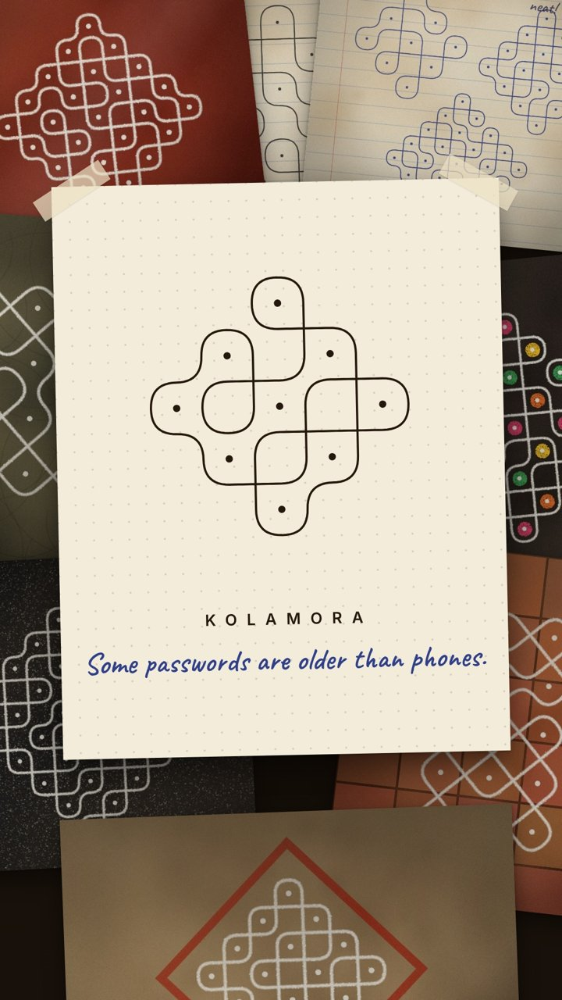

# Kolamora

**Face ID protects your phone. Kolams protected the whole house.**

Kolamora is a small web app that teaches the pulli kolam, the traditional line drawing looped around a grid of dots, and lets you use one as your key. You learn the form in three lessons, pick or draw your own kolam, practise it until you know it by heart, then draw it to get back in. Ants come to eat the rice flour, as they always did.



## Features

- **Lessons**: go around the dot, tie the knot (the sikku), and don't lift your finger
- **Your kolam**: generated as one unbroken line around every dot, or drawn by hand
- **Practice**: trace it with a glowing guide, then without the glow, then from memory
- **Lock screen**: the app asks for your kolam every time you come back to it
- **Ants**: they scatter at a wrong kolam and gather on the right one
- **Installable**: adds to the home screen, opens full-screen and works offline
- **Private**: your kolam is saved on your phone only and never uploaded

## Files

| File | Purpose |
|---|---|
| `index.html` | The whole app (HTML, CSS and JavaScript, using p5.js from cdnjs) |
| `manifest.webmanifest` | App name, icon and colours, used when installing to a home screen |
| `sw.js` | Service worker that keeps the app working offline |
| `icons/` | App icons for iPhone, Android and the browser tab |
| `preview.jpg` | Image used in this README |
| `.nojekyll` | Tells GitHub Pages to serve the files as they are |

## Host it on GitHub Pages

1. Sign in to GitHub and click **New repository**. Name it `kolamora`, set it to **Public**, and click **Create repository**.
2. On the new repository page, click **uploading an existing file**.
3. Open the unzipped `kolamora` folder, select everything inside it (including the `icons` folder), and drag it onto the page. Click **Commit changes**.

   `.nojekyll` and `.gitignore` are hidden files. On a Mac press **Cmd + Shift + .** in Finder to show them; on Windows turn on **View → Hidden items**. If `.nojekyll` gets left out, the app still works.

4. Go to **Settings → Pages**. Under **Build and deployment**, set **Source** to **Deploy from a branch**, choose the **main** branch and the **/ (root)** folder, then click **Save**.
5. Wait a minute or two, then refresh the Pages settings. Your address appears at the top, for example `https://your-username.github.io/kolamora/`.

GitHub Pages is free for public repositories. Private repositories need a paid GitHub plan to use Pages.

### Using the command line instead

```bash
cd kolamora
git init
git add .
git commit -m "Kolamora web app"
git branch -M main
git remote add origin https://github.com/YOUR-USERNAME/kolamora.git
git push -u origin main
```

Then turn on Pages as in step 4.

### Custom domain (optional)

To use an address like `kolamora.become.team`:

1. In **Settings → Pages → Custom domain**, enter the domain and click **Save**.
2. At your domain provider, add a **CNAME** record pointing `kolamora` to `YOUR-USERNAME.github.io`.
3. Once GitHub has checked the domain, tick **Enforce HTTPS**.

## Install it on a phone

**iPhone**: open the address in **Safari**, tap **Share**, then **Add to Home Screen**.
**Android**: open the address in **Chrome**, tap **⋮**, then **Install app** or **Add to Home screen**.

On iPhone, always open Kolamora from the home screen icon. It keeps its own storage, so your kolam stays saved.

## Updating

Upload the changed files to the repository (or `git push`). GitHub Pages republishes within a minute or two, and phones pick up the new version the next time Kolamora opens with a connection.

## Good to know

- Kolamora is a learning app and a ritual. It does not replace your phone's real passcode or lock other apps.
- Each phone keeps its own kolam. Clearing the browser's site data removes it.
- After three wrong tries, the app offers to teach your kolam again.
